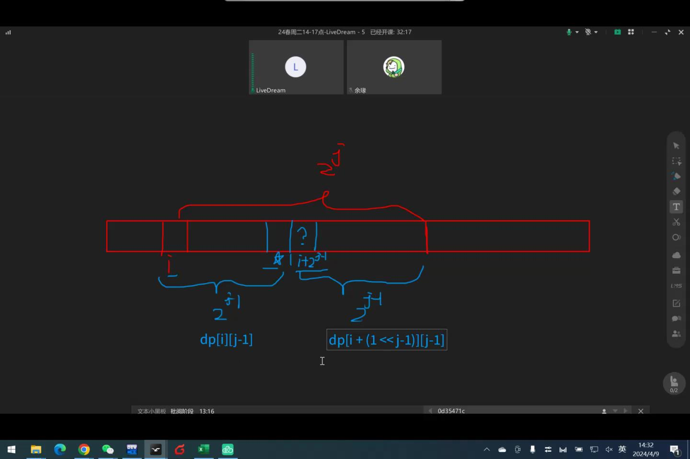
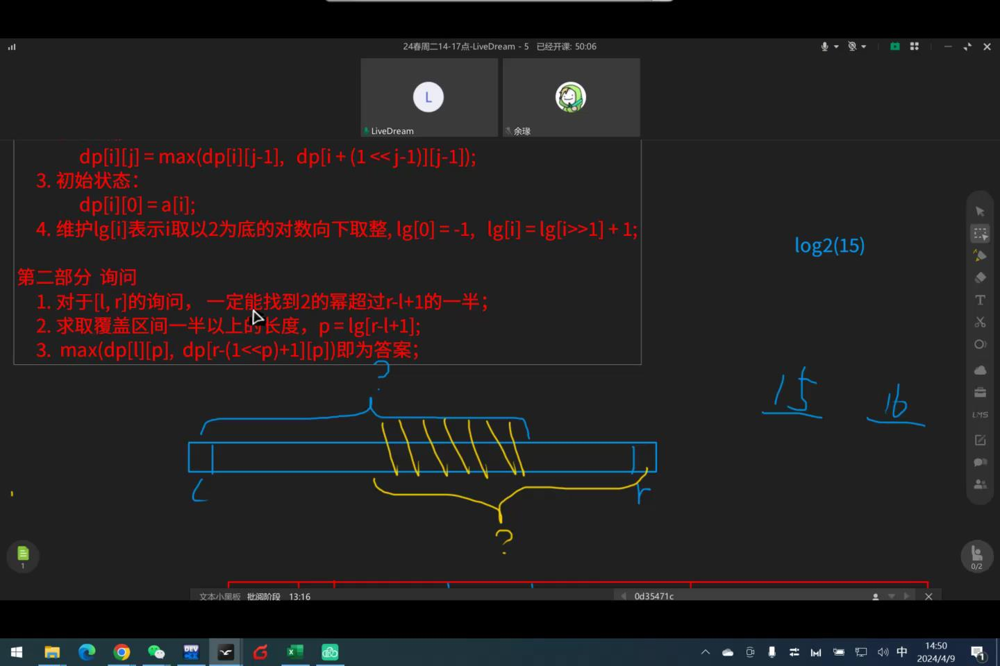

> 又称（Range Maximum/Minimum Query）

指的是在一个序列中，多次进行静态区间询问最值。

## 算法思想

倍增。

## 代码实现

### 预处理

以最大值为例。

1.  维护`dp[i][j]`表示以$i$为起点，跨度为$2^j$的最大值。
2.  状态转移：`dp[i][j]=max(dp[i][j-1],dp[i+(1<<j-1)][j-1])`（如下图）。
3.  初始状态：`dp[i][0]=a[i]`。
4.  维护`lg[i]`表示$i$取以$2$为底$n$的对数。



```cpp
void init() //initial
{
    lg[0]=-1;
    for(int i=1;i<=n;i++)
    {
        dp[i][0]=a[i];
        lg[i]=lg[i>>1]+1;
    }
    for(int j=1;(1<<j)<=n;j++) //枚举指数 j
        for(int i=1;i+(1<<j)-1<=n;i++) //枚举起点 i，注意终点不越界 
            dp[i][j]=max(dp[i][j-1],dp[i+(1<<j-1)][j-1]); 
    return ;
}
```

时间复杂度：$O(n \log n)$。

### 询问

1.  对于$L\sim R$的询问（闭区间），一定能找到$2$的幂超过$R-L+1$的一半。
2.  求取覆盖区间一半以上的长度，`p=lg[R-L+1]`。
3.  `max(dp[L][p],dp[R-(1<<p)+1][p])`即为答案（如下图）。



```cpp
int rmq(int L,int R)
{
	int p=lg[R-L+1];
	return max(dp[L][p],dp[R-(1<<p)+1][p]);
}
```

时间复杂度：$O(1)$。

## 例题

### P3865 【模板】ST 表

模板。

```cpp
#include<bits/stdc++.h>
using namespace std;
#define int long long

const int N=1e5+5;
int n,m,dp[N][25],a[N],lg[N];

void init()
{
	lg[0]=-1;
	for(int i=1;i<=n;i++)
	{
		dp[i][0]=a[i];
		lg[i]=lg[i>>1]+1;
	}
	for(int j=1;(1<<j)<=n;j++)
		for(int i=1;i+(1<<j)-1<=n;i++)
			dp[i][j]=max(dp[i][j-1],dp[i+(1<<j-1)][j-1]); 
	return ;
}

int rmq(int L,int R)
{
	int p=lg[R-L+1];
	return max(dp[L][p],dp[R-(1<<p)+1][p]);
}

signed main()
{
	ios::sync_with_stdio(false);
	cin.tie(0);
	cout.tie(0);
	cin>>n>>m;
	for(int i=1;i<=n;i++)
		cin>>a[i];
	init();
	while(m--)
	{
		int lt,rt;
		cin>>lt>>rt;
		cout<<rmq(lt,rt)<<"\n";
	}
	return 0;
}
```

### P2251 质量检测

同上。

```cpp
void pre_rmq()
{
	lg[0]=-1;
	for(int i=1;i<=n;i++)
	{
		dp[i][0]=a[i];
		lg[i]=lg[i>>1]+1;
	}
	for(int j=1;(1<<j)<=n;j++)
		for(int i=1;i+(1<<j)-1<=n;i++)
			dp[i][j]=min(dp[i][j-1],dp[i+(1<<j-1)][j-1]);
	return ;
}

int rmq(int x,int y)
{
	int len=lg[y-x+1];
	return min(dp[x][len],dp[y-(1<<len)+1][len]);
}
```

### P2880 [USACO07JAN] Balanced Lineup G

同时处理最大值和最小值的RMQ，取差即可。

```cpp
void init()
{
	lg[0]=-1;
	for(int i=1;i<=n;i++)
	{
		dp[i][0][0]=dp[i][0][1]=a[i];
		lg[i]=lg[i>>1]+1;
	}
	for(int j=1;(1<<j)<=n;j++)
		for(int i=1;i+(1<<j)-1<=n;i++)
		{
			dp[i][j][0]=max(dp[i][j-1][0],dp[i+(1<<j-1)][j-1][0]); 
			dp[i][j][1]=min(dp[i][j-1][1],dp[i+(1<<j-1)][j-1][1]); 
		}
	return ;
}

int rmq(int L,int R)
{
	int p=lg[R-L+1];
	return max(dp[L][p][0],dp[R-(1<<p)+1][p][0])-min(dp[L][p][1],dp[R-(1<<p)+1][p][1]);
}
```

### P2048 [NOI2010] 超级钢琴

#### 题意

给定$n$个元素，选取$k$次不完全重复的区间，区间长度在$[L,R]$内，求$k$次选取区间和的最大值。

#### 简化版

$k=1$时：

1.  维护`sum[i]`表示$i$的前缀和。
2.  维护`dp[i][j]`表示以$i$为起点，跨度为$2^j$的区间的最大值。
3.  维护`pos[i][j]`表达`dp[i][j]`在序列中的下标。（标准版要用）
4.  循环枚举区间起点$i$，在$[i+L-1,\min(n,i+R-1)](i+L-1 \le n)$询问最大的前缀和，减去`sum[i-1]`，维护最大差值。

#### 非简化版

5.  考虑大根堆维护前$k$大的区间和，问题是起点$i$个贡献不一定只有一个。
6.  对于以$i$为起点的区间和可以借助`pos`数组找到终点$j$，然后在区间$[i+L-1,j-1]$和$[j+1,i+R-1]$再次寻找$2$个最大区间，对应的$j1,j2$，插入大根堆。
7.  循环从优先队列中取出$k$个区间，每取一次，将被取出的区间终点$j$一分为二，重复$k$次，求和即为答案。

总时间复杂度：$O(n \log n +k \log n)$。

---

代码：

```cpp
#include<bits/stdc++.h>
using namespace std;
#define int long long 

const int N=5e5+5;
int n,k,ll,rr,sum[N],pos[N][23],dp[N][23],lg[N],a[N],ans;
class Node{public:int st,fj,lt,rt,val;bool operator<(const Node& tmp)const{return val<tmp.val;}};
priority_queue<Node>pq;

void init()
{
	lg[0]=-1;
	for(int i=1;i<=n;i++)
	{
		dp[i][0]=sum[i];
		pos[i][0]=i;
		lg[i]=lg[i>>1]+1;
	}
	for(int j=1;(1<<j)<=n;j++)
		for(int i=1;i+(1<<j)-1<=n;i++)
		{
			if(dp[i][j-1]>dp[i+(1<<j-1)][j-1])
				dp[i][j]=dp[i][j-1],pos[i][j]=pos[i][j-1];
			else
				dp[i][j]=dp[i+(1<<j-1)][j-1],pos[i][j]=pos[i+(1<<j-1)][j-1];
		}
	return ;
}

int rmq(int L,int R)
{
	int p=lg[R-L+1];
	if(dp[L][p]>dp[R-(1<<p)+1][p])
		return pos[L][p];
	return pos[R-(1<<p)+1][p];
}

signed main()
{
	cin>>n>>k>>ll>>rr;
	for(int i=1;i<=n;i++)
	{
		cin>>a[i];
		sum[i]=sum[i-1]+a[i];
	}
	init();
	for(int i=1;i+ll-1<=n;i++)
	{
		int ip=rmq(i+ll-1,min(n,i+rr-1));
		int val=sum[ip]-sum[i-1];
		pq.push({i,ip,i+ll-1,min(n,i+rr-1),val});
	}
	while(k--)
	{
		Node cur=pq.top();
		pq.pop();
		ans+=cur.val;
		if(cur.lt<cur.fj)
		{
			int ip=rmq(cur.lt,cur.fj-1);
			int val=sum[ip]-sum[cur.st-1];
			pq.push({cur.st,ip,cur.lt,cur.fj-1,val});
		}
		if(cur.fj<cur.rt)
		{
			int ip=rmq(cur.fj+1,cur.rt);
			int val=sum[ip]-sum[cur.st-1];
			pq.push({cur.st,ip,cur.fj+1,cur.rt,val});
		}
	}
	cout<<ans;
	return 0;
}
```

### P7167 [eJOI2020 Day1] Fountion

1.  单调栈处理第$i$个圆盘的水回落到的圆盘编号。
2.  维护`nxt[i][j]`表示第$i$个圆盘向下走$2^j$步到达的圆盘编号。
3.  维护`sum[i][j]`表示第$i$个圆盘向下走$2^j$步的区间内所有圆盘的容量之和。

代码：

```cpp
#include<bits/stdc++.h>
using namespace std;
#define int long long

const int N=1e5+5;
int n,q,D[N],C[N],R[N][25],sum[N][25];
stack<int>stk;

signed main()
{
    cin>>n>>q;
    for(int i=1;i<=n;i++)
        cin>>D[i]>>C[i];
    for(int i=1;i<=n;i++)
    {
        while(stk.empty()==false&&D[stk.top()]<D[i])
        {
            R[stk.top()][0]=i;
            sum[stk.top()][0]=C[stk.top()]+C[i];
            stk.pop();
        }
        stk.push(i);
    }
    while(stk.empty()==false)
    {
        sum[stk.top()][0]=C[stk.top()];
        stk.pop();
    }
    for(int i=n;i>=1;i--)
        for(int j=1;j<=20;j++)
            {
                R[i][j]=R[R[i][j-1]][j-1];
                sum[i][j]=sum[i][j-1]+sum[R[i][j-1]][j-1]-C[R[i][j-1]];
            }
    while(q--)
    {
        int r,v;
        cin>>r>>v;
        v-=C[r];
        for(int i=20;i>=0;i--)
        {
            if(sum[r][i]-C[r]<v)
            {
                v-=sum[r][i]-C[r];
                r=R[r][i];
            }
        }
        if(v<=0)
            cout<<r<<"\n";
        else
            cout<<R[r][0]<<"\n";
    }
    return 0;
}
```

### P1613 跑路

1.  维护`yes[i][j][k]`表示点$i$是否能通过跑路器走$2^k$步到达点$j$。
2.  维护`dis[i][j]`表示$i \to j$的最短路，初始连边和前述的预处理。
3.  跑 floyd 求最短路。

```cpp
#include<bits/stdc++.h>
using namespace std;
#define int long long

const int N=55;
int n,m,g[N][N];
bool dis[N][N][70];

void floyd()
{
	for(int k=1;k<=n;k++)
		for(int i=1;i<=n;i++)
			for(int j=1;j<=n;j++)
				g[i][j]=min(g[i][j],g[i][k]+g[k][j]);
	return ;
}

signed main()
{
	memset(g,0x3f,sizeof g);
	cin>>n>>m;
	for(int i=1;i<=m;i++)
	{
		int x,y;
		cin>>x>>y;
		dis[x][y][0]=true;
		g[x][y]=1;
	}
	for(int bas=1;bas<=65;bas++)
		for(int k=1;k<=n;k++)
			for(int i=1;i<=n;i++)
				for(int j=1;j<=n;j++)
					if(dis[i][k][bas-1]==true&&dis[k][j][bas-1]==true)
						dis[i][j][bas]=true,g[i][j]=1;
	floyd();
	cout<<g[1][n];
	return 0;
}
```