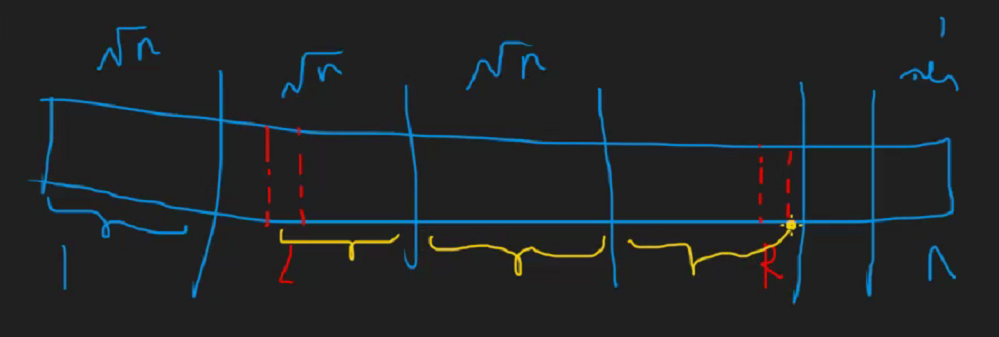

## 分块思想

> 越暴力的算法适用范围更广……

其实就是分治思想，以我们老师的一幅奇怪的图为例。



如果我们要求$L$到$R$的区间，那么我们可以将原数组分为$\sqrt{n}$个区间，每一个里面都有$\sqrt{n}$个元素（当然最后有可能有遗漏，不足$\sqrt{n}$），于是我们可以预处理出每一个区间内的情况，然后在询问时“暴力”枚举。

一般为以下几种情况：

1.  整个块，那么加上预处理结果（图中黄色中间线段）
2.  左边要加上暴力循环结果（图中黄色左侧线段）
3.  右边同理

以[P1816 忠诚](https://www.luogu.com.cn/problem/P1816)为例讲解

### 预处理

```cpp
void init(){
	int t = sqrt(m);
	for(int i = 1 ; i <= t; i++){//预处理每一个块
		L[i] = (i - 1) * t + 1;
		R[i] = i * t;
	}
	if(R[t] <= m){//多余的块
		t++;
		L[t] = R[t - 1] + 1 , R[t] = m;
	}
	memset(sum , 0x3f , sizeof(sum));
	for(int i = 1 ; i <= t ; i++){
		for(int j = L[i] ; j <= R[i] ; j++){
			pos[j] = i;//预处理每一个下标所对应的块
			sum[i] = min(sum[i] , a[j]); //预处理最小值（当然其他也可以）
		}
	}
	return ;
}
```

### 询问

```cpp
int query(int x , int y){
	int px = pos[x] , py = pos[y];
	int mini = 0x3f3f3f3f;
	if(px == py){//如果本身在同一个块内，直接暴力
		for(int i = x ; i <= y ; i++){
			mini = min(mini , a[i]);
		}
	}
	else{
		for(int i = px + 1 ; i <= py - 1 ; i++){//整块的
			mini = min(sum[i] , mini);
		}
		for(int i = x ; i <= R[px] ; i++){//左边的
			mini = min(mini , a[i]);
		}
		for(int i = L[py] ; i <= y ; i++){//右边的
			mini = min(mini , a[i]);
		}
	}
	return mini;
}
```

## 带修改分块

其实和线段树类似，可以使用懒标记。

1.  若是完整的块，需要打上懒标记
2.  若是不完整的块，不要打懒标记，需要修改原值

询问的时候需要注意加上懒标记，其他没什么好说的

以[P3372 【模板】线段树 1](https://www.luogu.com.cn/problem/P3372)为例（反正跟线段树很像）

### 修改懒标记

```cpp
void update(int x , int y , int k){
	int px = pos[x] , py = pos[y];
	if(px == py){//如果在同一块，直接修改
		for(int i = x ; i <= y ; i++){
			a[i] += k;
		}
		sum[px] += k * (y - x + 1);
	}
	else{
		for(int i = px + 1 ; i < py ; i++){
			tag[i] += k;//标tag
		}
		for(int i = x ; i <= R[px] ; i++){
			a[i] += k;
		}
		sum[px] += k * (R[px] - x + 1);//一定要注意加上
		for(int i = L[py] ; i <= y ; i++){
			a[i] += k;
		}
		sum[py] += k * (y - L[py] + 1);
	}
	return ;
}
```

### 询问

```cpp
int query(int x , int y){
	int px = pos[x] , py = pos[y];
	int ans = 0;
	if(px == py){
		for(int i = x ; i <= y ; i++){
			ans = ans + a[i];
		}
		ans += tag[px] * (y - x + 1);//注意所有tag的地方不能忘
	}
	else{
		for(int i = px + 1 ; i <= py - 1 ; i++){
			ans += sum[i] + tag[i] * (R[i] - L[i] + 1);
		}
		for(int i = x ; i <= R[px] ; i++){
			ans += a[i];
		}
		ans += tag[px] * (R[px] - x + 1);//补上tag
		for(int i = L[py] ; i <= y ; i++){
			ans += a[i];
		}
		ans += tag[py] * (y - L[py] + 1);
	}
	return ans;
}
```

## 其他题目

### [#6278. 数列分块入门 2](https://loj.ac/p/6278)

这道题其实发现有限制，于是乎我们要对每一个块进行排序