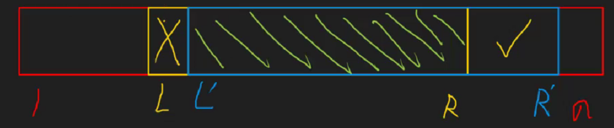
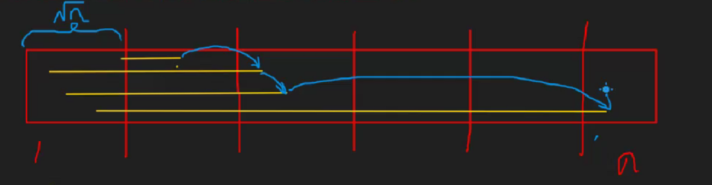
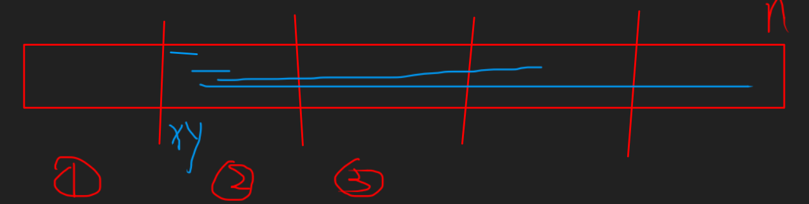

> 又称 Mo's Algorithm。

是一种离线算法，将询问统筹规划之后，按特定的顺序处理。

使用场景：两个相邻的区间，可以$O(1)$转移时，考虑莫队。

## 模板 P2709 小B的询问

对于两次询问$L,R$，$L',R'$，满足$L<L'<R<R'$，那么$[L',R]$是重叠部分，若不多计算这段重叠部分，则对于$[L,R]$的答案，只需要减少$[L,L']$(黄色部分)，增加$[R,R']$(蓝色部分)。（如下图）

对于一个平面直角坐标系，将一此询问的$L,R$对应成一个点，坐标为$(L,R)$，那么两次询问的增量即为其之间的曼哈顿距离。

因此莫队理论上的最优时间复杂度取决于关于曼哈顿距离的最小生成树。

对于数组进行[分块](https://memset.yuque.com/org-wiki-memset-fk7vsw/kgy4gn/nvenyerurbtg8nxo)，每次询问先按块从小到大排序，同一个块里的按右端点排序，从右端点一直跳，最多跳$n$次，由于最多只有$n$个块，最多时间复杂度为$O(n\sqrt n)$。

总时间复杂度$O(m \sqrt n)$。

## 莫队的奇偶优化

若$y$一直从$1$跑到$n$，再从$n$跑到$1$，会消耗很多时间，因此将奇数块从小到大排序，偶数块从大到小排序，可节省$2$倍常数。